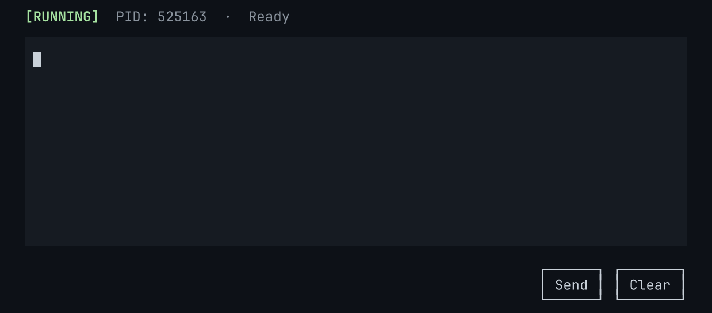

# `QmlTui.PtyView`

Embedded Unix pseudo-terminal (PTY) viewport for [QmlTui](https://github.com/qmltui/qmltui) backed by POSIX `openpty` and [`libvterm`](https://www.leonerd.org.uk/code/libvterm/). Supported on **Linux** and **macOS**.

For a full-featured showcase using `QmlTui.PtyView`, see [`file_manager`](https://github.com/qmltui/apps/tree/main/apps/file_manager) in [`qmltui/apps`](https://github.com/qmltui/apps).



## Provided Types (`import QmlTui.PtyView`)

| Type | Kind | Summary |
| :--- | :--- | :--- |
| `PtyView` | C++ `qmltui::Item` | Hosts an interactive child process inside a Unix PTY (`openpty` + `libvterm`), rendering cells, colors, scrollback, and a vertical scrollbar while forwarding keyboard, paste, and SGR mouse events. |

## Quick Usage

```qml
pragma ComponentBehavior: Bound

import QtQml
import QmlTui
import QmlTui.PtyView

Terminal {
    id: root

    PtyView {
        id: pty
        anchors.fill: parent
        focus: true
        program: defaultUserShell()
        arguments: ["-l"]
        autoStart: true

        Keys.priority: Keys.BeforeItem
        Keys.onPressed: event => {
            if ((event.modifiers & Qt.ControlModifier) && event.key === Qt.Key_Q) {
                pty.terminate();
                Qt.quit();
                event.accepted = true;
            }
        }

        onFinished: exitCode => Qt.quit()
    }
}
```

## Consuming via CMake `FetchContent`

```cmake
include(FetchContent)
FetchContent_Declare(
    qmltui_ptyview
    GIT_REPOSITORY https://github.com/qmltui/ptyview.git
    GIT_TAG main
    GIT_SHALLOW TRUE
)
FetchContent_MakeAvailable(qmltui_ptyview)

target_link_libraries(my_app PRIVATE QmlTui::Core QmlTui::PtyView)
```

In `qt_add_qml_module`, declare `DEPENDENCIES TARGET QmlTuiPtyView` for `qmllint` static analysis, then `import QmlTui.PtyView`.

Pass `-DQMLTUI_PTYVIEW_USE_SYSTEM_LIBVTERM=ON` to consume a system-installed `libvterm` (`vterm >= 0.3` via `pkg-config`) instead of fetching the pinned `libvterm` 0.3.3 tarball via `FetchContent`.

## Standalone Build & Tests

```sh
cmake -S . -B build -DFETCHCONTENT_SOURCE_DIR_QMLTUI=/path/to/qmltui
cmake --build build
ctest --test-dir build -LE Demo --output-on-failure
./build/examples/hello_ptyview/ptyview_hello
```

To build against an installed `QmlTui` prefix:

```sh
cmake -S . -B build -DQMLTUI_USE_INSTALLED=ON -DCMAKE_PREFIX_PATH=/path/to/qmltui-prefix
cmake --build build
ctest --test-dir build -LE Demo --output-on-failure
```

## Documentation & Security

- **[Usage Guide](docs/guide.md)**: Process configuration, key interception, focus escape, scrollback, OSC security defaults, and Runner testing.
- **[API Reference](docs/reference.md)**: QML and C++ properties, signals, methods, and `ProcessState` enumeration.
- **Process execution safety**: `PtyView` launches `program` and `arguments` directly via `QProcess::start()` without shell interpolation. It only falls back to `QProcess::splitCommand(program)` when `arguments` is empty and `program` is not an existing executable path—applications should pass explicit `arguments` and never pass untrusted strings in `program`.
